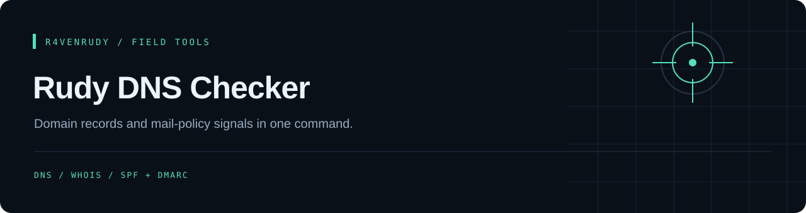

<p align="center"></p>

<p align="center">
  
  
  <a href="LICENSE"></a>
</p>

<p align="center"><strong>Domain records and mail-policy signals in one command.</strong></p>

<p align="center"><a href="#overview">Overview</a> · <a href="#capabilities">Capabilities</a> · <a href="#email-security-spf--dmarc--dkim--mta-sts">Mail policy</a> · <a href="#quick-start">Quick start</a> · <a href="#implementation-notes">Implementation notes</a></p>

---

## Overview

A Discord `/domain` bot that resolves public DNS records, queries WHOIS and summarizes SPF/DMARC policy signals in an embed. DNS queries run concurrently and failed lookups are represented by empty results.

## Capabilities

| Layer | Implemented behavior |
| :--- | :--- |
| DNS | A (with reverse DNS for the first five), AAAA, NS, MX (sorted by priority, null MX explained), TXT, CNAME, SOA and CAA lookups; DNSSEC from the DS record via Cloudflare DNS-over-HTTPS |
| Mail policy | SPF presence/multiplicity and `all` qualifiers; DMARC policy summary; DKIM keys at common selectors |
| WHOIS | Registrar, creation, update and expiry dates, EPP status codes (transfer/delete locks) (first non-empty value across WHOIS servers, 10 s timeout); warns when a domain expires within 30 days |
| Discord | Registers `/domain` globally and returns a structured embed; accepts pasted URLs (`https://example.com/path` becomes `example.com`) and Turkish or other internationalized names (converted to punycode) |

## Email Security (SPF / DMARC / DKIM / MTA-STS)

- Flags missing or duplicate SPF records
- Warns on permissive +all / ?all (a bare `all` counts as +all) and softfail ~all
- Recognizes `redirect=` delegation instead of warning about a missing `all`
- Reads the DMARC policy from _dmarc.<domain> (none / quarantine / reject)
- Warns when DMARC `pct` is below 100 and when no `rua` reporting address is set
- Reports a DMARC record without a valid `p=` tag as invalid
- Probes DKIM at common selectors (google, selector1, selector2, default, k1, s1, s2, dkim, mail); a custom selector will not be found
- For domains with MX records, notes whether MTA-STS (`_mta-sts` TXT) and TLS-RPT (`_smtp._tls` TXT) are published

These are record summaries, not a complete SPF evaluation. The bot does not test whether a real message passes SPF, DKIM or DMARC.

## Quick start

Requires **Node.js 24 or newer**, npm and a Discord application. Keep the bundled `raven.png`; startup verifies its PNG signature. Run the commands from the repository root.

```bash
git clone https://github.com/r4venrudy/rudy-dns-checker.git
cd rudy-dns-checker
npm ci
```

Copy `.env.example` to a local `.env` file, then fill in your bot token and application ID:

```dotenv
DISCORD_TOKEN=YOUR_DISCORD_BOT_TOKEN
CLIENT_ID=YOUR_DISCORD_APPLICATION_ID
```

Keep `.env` private; it is ignored by Git. Node loads it only when you pass `--env-file`. First check the installation without connecting to Discord:

```bash
node --env-file=.env index.js --check-config
```

A successful check prints `Configuration and dependencies ready` and exits. It checks required settings, the application-ID format, installed dependencies and the bundled asset; it does not authenticate the token or validate Discord permissions. After filling in real values, start the bot:

```bash
node --env-file=.env index.js
```

Invite the bot with `bot` and `applications.commands` scopes, then run `/domain example.com`.

Existing local `config.json` files remain supported with `token` and `clientId` keys. Exported environment variables take priority over the JSON values; `RUDY_CONFIG` selects another JSON file. Do not commit either credential file.

For an offline configuration regression check, run `npm test`. No real token or DNS lookup is needed for those tests.

## Implementation notes

- The actual slash command is `/domain`; this is a domain/DNS bot rather than an IP lookup bot.
- SPF and DMARC checks are lightweight string heuristics. They do not recursively evaluate SPF includes, validate DKIM keys or the DNSSEC chain, or certify mail delivery.
- WHOIS response shape varies; registrar and date fields can be unavailable. Long answers are shortened so the embed stays under Discord's 6000 character limit.
- Run from the repository root because configuration and asset paths use the working directory. Replies are channel-visible; API availability and Discord setup require live validation.

## Project map

```text
index.js       DNS, WHOIS, mail-policy checks and Discord command
package.json   ES-module configuration and dependencies
.env.example   Template for private runtime settings
config.json    Optional local JSON credentials
packaging/     Configuration loader and offline tests
raven.png      Required startup asset
```

## GitHub package

A non-root container is published to GitHub Packages after build and offline configuration checks. Credentials are supplied at runtime and are excluded from the image.

```sh
cp .env.example .env
# Fill in your own values in .env, keeping that file private.
docker run --rm --env-file .env ghcr.io/r4venrudy/rudy-dns-checker:latest --check-config
docker run --rm --env-file .env ghcr.io/r4venrudy/rudy-dns-checker:latest
```

`--check-config` validates installed dependencies, the bundled asset, and required settings without connecting to Discord. `RUDY_CONFIG` optionally points to a mounted JSON configuration file; environment variables take priority.

Only public project files are packaged. Image tags are `latest` and `sha-<full commit SHA>`. Discord login and external API behavior still require your own account configuration; CI never uses live credentials.


## License

[MIT](LICENSE). Preserve the attribution in the license file.

---

<p align="center">Part of the <a href="https://github.com/r4venrudy">r4venrudy</a> project collection.</p>
